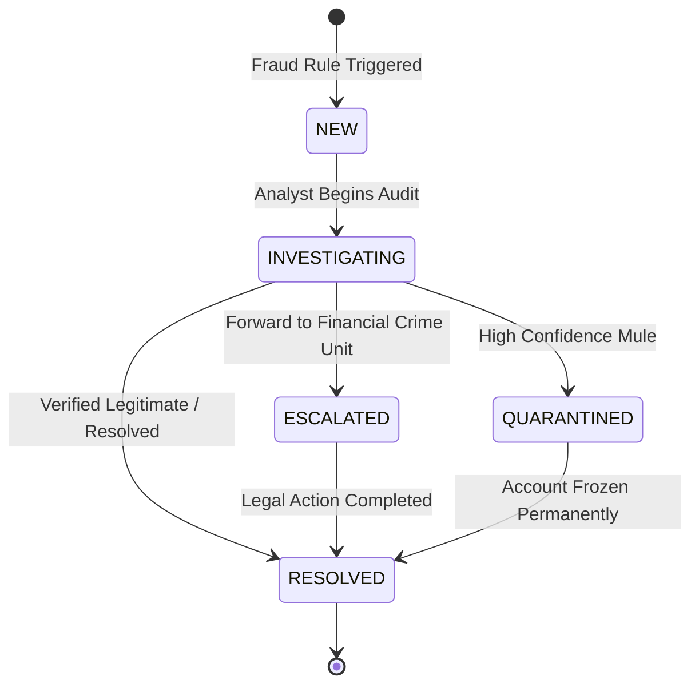

# 📖 Comprehensive Technical Architecture & Platform Handbook: Sentinel Real-Time UPI & Mule Account Platform

---

## 📌 1. Project Mission & Enterprise Overview

### What is Sentinel?
Sentinel is an **enterprise-grade, real-time streaming financial cyber-intelligence platform** specifically engineered to detect, investigate, and visually untangle **Money Mule Networks, Rapid In-to-Out Fund Draining, Fan-In Smurfing Aggregation, Fan-Out Dispersal, Multi-Hop Layering Chains, Circular Transaction Loops, and Structuring Evasion** across UPI (Unified Payments Interface) and instant digital payment systems.

### The Operational Challenge in Instant Digital Payments
In contemporary digital banking and UPI scams:
1. **Victim Inflow**: Fraudsters coerce or trick victims into transferring money into a compromised account (**Tier-1 Money Mule**).
2. **Sub-Minute Layering**: Within seconds (often $< 15$ to $60$ seconds), the mule forwards the money to intermediary mules (**Tier-2 / Tier-3**) or disperses it across multiple runners.
3. **Rapid Liquidation**: Funds are off-ramped via ATM cardless withdrawals, hawala syndicates, or P2P crypto merchants before traditional batch systems can run overnight queries.
4. **The Latency Problem**: Traditional fraud batch engines that run hourly or overnight SQL jobs discover the crime **hours too late**, after the funds have irreversibly departed the formal banking rails.
5. **Sentinel's Solution**: Sentinel evaluates transactions in stream time with **sub-millisecond latency** the moment an outflow occurs, computing exact **Time-to-Drain** velocity, **Drain Percentage**, graph degree centrality, and multi-hop paths in real time.

---

## 📊 2. Dataset Specification (`data/transactions.csv`)

The platform ingests `data/transactions.csv`, containing **9,077 real-world and synthetic UPI transactions** (8,579 SUCCESS, 498 FAILED):

| Column | Type | Description | Example |
| :--- | :--- | :--- | :--- |
| `transaction_id` | String | Unique transaction reference identifier | `099ee548-2fc1-4811-bf92-559c467ca792` |
| `timestamp` | String/DateTime | Transaction occurrence time (`YYYY-MM-DD HH:mm:ss`) | `2024-06-19 06:04:49` |
| `sender_name` | String | Legal name of remitter | `Mohanlal Bakshi` |
| `sender_vpa` | String | Virtual Payment Address of sender | `8908837379@okaxis` |
| `receiver_name` | String | Legal name of payee / beneficiary | `Mehul Sankaran` |
| `receiver_vpa` | String | Virtual Payment Address of receiver | `7683454560@okaxis` |
| `amount` | Float | Transferred amount in Indian Rupees (₹) | `8404.55` |
| `status` | String | Transfer status (`SUCCESS` or `FAILED`) | `SUCCESS` |
| `bank_code` | String | Participating PSP bank | `AXIS`, `HDFCBANK`, `ICICI`, `SBI`, `YBL` |
| `location` | String | Transaction origination city / region | `Delhi`, `Mumbai`, `Ahmedabad`, `Pune` |

> **Settlement Gate**: Transactions with `status === 'FAILED'` are tracked for velocity telemetry but filtered from drain ratio calculations because zero financial value settled.

---

## 🔄 3. Dual-Engine Architecture

Sentinel is architected with dual operating modes for maximum flexibility and demonstration readiness:

| Capability | Mode 1: Zero-Dependency High-Performance Core | Mode 2: Distributed Production Cluster |
| :--- | :--- | :--- |
| **Runtime Requirements** | Native Node.js (v16+) | Docker Desktop (Docker Compose) |
| **Stream Engine** | In-Memory Sliding-Window CEP Engine | Apache Flink 1.17 (Java & PyFlink) |
| **Message Queue** | In-Process Event Streamer + SSE Gateway | Apache Kafka 7.5.0 (KRaft Mode) |
| **Graph Store** | In-Memory Directed Graph Store | ClickHouse Graph Queries & In-Memory Index |
| **Storage Backend** | JSON State Store (`cases.json`, `quarantined_accounts.json`) | ClickHouse 23.8 ReplacingMergeTree |
| **Primary Use Case** | Rapid local deployment, live SOC demonstration, zero-socket testing | High-volume distributed benchmarks & production scaling |

---

## 🗂️ 4. File-by-File Architecture Breakdown

```
MP1/
├── engine/                                  # Core Detection & Graph Intelligence
│   ├── rules.js                             # 6 Stateful CEP Fraud Detection Rules
│   ├── risk_scorer.js                       # Explainable Multi-Signal Risk Scorer (0-100)
│   ├── graph_store.js                       # Directed Transaction Graph Store & Cycle Tracker
│   ├── case_manager.js                      # SOC Case Lifecycle & Quarantine Enforcement
│   ├── simulator.js                         # 6-Scenario Attack Simulation Engine
│   └── clickhouse_client.js                 # Sub-second ClickHouse HTTP OLAP Client
├── web-dashboard/                           # Real-Time SOC Interface & API Broker
│   ├── server.js                            # High-Throughput HTTP & SSE Gateway
│   └── public/
│       ├── index.html                       # 9-View Security Operations Center Dashboard
│       ├── styles.css                       # Enterprise Dark Cybersecurity Styling
│       └── app.js                           # Canvas Graph Visualizer & State Controller
├── tests/                                   # Automated Validation Test Suites
│   ├── test_detection_engine.js             # Engine, Risk Scorer & Graph Unit Tests (7/7 Pass)
│   └── test_server_mock.js                  # Zero-Socket REST API Route Tests (9/9 Pass)
├── ingestion/                               # Dataset Streamers & Batch Processors
│   ├── dataset_streamer.js                  # Batch Scanner for transactions.csv
│   └── stream_simulator.js                  # Live Sequential Replay Generator
├── flink-jobs/                              # Distributed Stream Processing
│   ├── java/                                # Production Java Flink 1.17 Topology
│   └── python/                              # PyFlink KeyedProcessFunction Pipeline
├── clickhouse/                              # OLAP Storage & Analytical Queries
│   ├── init.sql                             # Database & Materialized View DDL
│   └── queries.sql                          # Sub-second Analytical Queries
├── data/                                    # Datasets & Reports
│   ├── transactions.csv                     # 9,077 UPI Transaction Records
│   └── alerts_output.json                   # Output Incident Ledger
├── docker/                                  # Containerized Stack Definitions
│   └── docker-compose.yml                   # Kafka (KRaft), Flink, ClickHouse Stack
├── README.md                                # Platform Architectural Specification
└── Explain.md                               # (This File) Comprehensive Handbook
```

---

## 🧠 5. Fraud Detection Algorithms & Mathematical Models

### 1. Rapid In-to-Out Pass-Through Mule (`RAPID_PASS_THROUGH_MULE`)
* **Concept**: Captures the temporal signature of a pass-through laundering account where funds arrive and are immediately drained.
* **Formulas**:
  $$\Delta t = t_{\text{debit}} - t_{\text{credit}}$$
  $$\text{Drain Ratio } (\%) = \left(\frac{\text{Amount}_{\text{debit}}}{\sum \text{Amount}_{\text{credit}}}\right) \times 100$$
* **Thresholds**: $\Delta t \le 120\text{s}$, $\text{Drain Ratio} \ge 70\%$, $\text{Amount} \ge ₹5,000$.
* **Severity**: $\text{CRITICAL}$ if $\Delta t \le 20\text{s}$, otherwise $\text{HIGH}$.

### 2. Fan-In Smurfing Aggregator (`FAN_IN_SMURFING_AGGREGATOR`)
* **Concept**: Detects accounts aggregating funds from multiple distinct remitter victims to avoid single-transaction threshold reporting.
* **Thresholds**: $\ge 3$ distinct remitter accounts transferring money to the same beneficiary within a 120-second sliding window.

### 3. Fan-Out Distribution Dispersal (`FAN_OUT_DISTRIBUTION`)
* **Concept**: Identifies a primary distributor dispersing money across multiple runners within a tight timeframe.
* **Thresholds**: 1 remitter dispersing funds to $\ge 3$ distinct beneficiaries within a 120-second window.

### 4. Multi-Hop Layering Chain (`MULTI_HOP_LAYERING`)
* **Concept**: Tracks money movements across consecutive intermediary accounts ($A \to B \to C \to D$).
* **Thresholds**: Hop depth $\ge 3$ with transfer velocity between consecutive hops $\le 180$ seconds.

### 5. Circular Transaction Loop (`CIRCULAR_TRANSACTION_LOOP`)
* **Concept**: Identifies circular money laundering or wash trading where funds return to the originator ($A \to B \to C \to A$).
* **Thresholds**: Cycle detected in directed transaction graph with hop depth between 3 and 4.

### 6. Structuring & Transaction Splitting (`STRUCTURING_SPLIT`)
* **Concept**: Multiple transactions executed just below the ₹50,000 regulatory reporting threshold within a short time interval.
* **Thresholds**: $\ge 3$ transactions between ₹25,000 and ₹49,999 from the same account within 60 seconds.

---

## ⚖️ 6. Explainable Risk Scoring Engine

Every alert is assigned an explainable score between **0 and 100** based on transparent contributing signals:

$$R_{\text{total}} = \min\left(99, R_{\text{base}} + S_{\text{velocity}} + S_{\text{drain}} + S_{\text{degree}} + S_{\text{layering}} + S_{\text{value}} + S_{\text{history}}\right)$$

| Signal | Max Weight | Condition & Points Allocation |
| :--- | :--- | :--- |
| **`RULE_TRIGGER_BASE`** | Base | **+40 pts** Baseline rule trigger |
| **`VELOCITY_PENALTY`** | Up to +25% | $\le 10$s: **+25 pts** \| $\le 30$s: **+20 pts** \| $\le 60$s: **+15 pts** \| $\le 120$s: **+10 pts** |
| **`DRAIN_RATIO_WEIGHT`**| Up to +20% | $\ge 95\%$: **+20 pts** \| $\ge 85\%$: **+15 pts** \| $\ge 70\%$: **+10 pts** |
| **`NETWORK_CENTRALITY`**| Up to +20% | Degree $\ge 6$: **+20 pts** \| $\ge 4$: **+15 pts** \| $\ge 3$: **+10 pts** |
| **`MULTI_HOP_LAYERING`**| Up to +15% | +5 pts per hop above 2 (up to +15 pts) |
| **`CIRCULAR_LOOP`** | Up to +15% | **+15 pts** if directed cycle detected |
| **`HIGH_VALUE_EXPOSURE`**| Up to +10% | $\ge ₹1,00,000$: **+10 pts** \| $\ge ₹50,000$: **+5 pts** |
| **`RECIDIVISM_HISTORY`**| Up to +10% | +3 pts per previous alert (up to +10 pts) |
| **`QUARANTINE_OVERRIDE`**| Critical | **+10 pts** if under active quarantine |

---

## 🕸️ 7. Interactive Money Flow Network Visualizer

Implemented in pure HTML5 Canvas (`web-dashboard/public/app.js`):
- **Force-Directed Layout**: Computes dynamic node positioning with collision detection and spring attraction along edges.
- **Node Classification & Visual Styling**:
  - `Normal Account`: Sky Blue (`#38bdf8`)
  - `Aggregator (Smurfing)`: Amber (`#f59e0b`)
  - `Dispersal (Fan-Out)`: Cyan (`#06b6d4`)
  - `Mule Account`: Red (`#ef4444`)
  - `Critical Threat`: Crimson (`#ff1744`)
  - `Quarantined Account`: Purple (`#a855f7`)
- **Directed Edges**: Curved arrows with thickness proportional to transaction value and animated direction vectors.
- **Interactive Controls**: Pan, zoom (wheel), node drag, and click-to-inspect opening the Account Dossier.
- **Topological Analysis**: "Highlight Chains" and "Detect Cycles" buttons for instant visual threat identification.

---

## 🔍 8. SOC Investigation & Case Management Workflow



---

## 🧪 9. Simulation Lab & Synthetic Attack Vectors

The Simulation Lab (`engine/simulator.js`) provides 6 repeatable real-world financial attack scenarios:

1. **Rapid Pass-Through**: Victim remits ₹75,000 to Mule Tier-1; Mule drains ₹72,000 (96%) in 3.5 seconds to a P2P crypto desk.
2. **Fan-In Smurfing**: 4 victims remit ₹32,000–₹45,000 to 1 central aggregator who drains ₹1,48,000 in bulk to a hawala syndicate.
3. **Fan-Out Distribution**: Distributor receives ₹1,80,000 and disperses ₹43,000–₹46,000 across 4 distinct runner accounts.
4. **Multi-Hop Layering**: 4-hop chain (Victim $\to$ Mule 1 $\to$ Mule 2 $\to$ Mule 3 $\to$ Gold Bullion Vault).
5. **Circular Transaction Loop**: Closed wash-trading loop ($A \to B \to C \to A$) between 3 synthetic corporate accounts.
6. **Structuring Attack**: 4 rapid transactions between ₹47,000 and ₹49,500 within 40 seconds to evade the ₹50,000 reporting limit.

---

## 📡 10. REST & Streaming API Reference

| Endpoint | Method | Description |
| :--- | :--- | :--- |
| `/api/stream` | `GET (SSE)` | Server-Sent Events stream emitting `transaction`, `alert`, and `case` payloads |
| `/api/stats` | `GET` | Real-time KPIs (Total transactions, volume, alerts, active mules, TPS, latency) |
| `/api/transactions` | `GET` | Query transactions (`?limit=50&status=SUCCESS&q=keyword`) |
| `/api/alerts` | `GET` | Query alerts (`?limit=50&rule=RULE_CODE&severity=CRITICAL`) |
| `/api/cases` | `GET` | Retrieve list of all SOC investigation cases |
| `/api/cases/status` | `POST` | Update case status (`{ caseId, status, analyst, comment }`) |
| `/api/cases/note` | `POST` | Add investigator note (`{ caseId, author, text }`) |
| `/api/account/:vpa` | `GET` | 360-degree forensic dossier for specified VPA |
| `/api/account/:vpa/quarantine` | `POST` | Toggle quarantine status (`{ reason, analyst }`) |
| `/api/network/graph` | `GET` | Cytoscape/Canvas graph data (`?focus=vpa&limit=70`) |
| `/api/analytics` | `GET` | Aggregated analytics (bank risk, geographic concentration, rule counts) |
| `/api/simulate/:scenario` | `GET/POST` | Trigger synthetic attack scenario |
| `/api/speed` | `GET` | Adjust stream replay speed (`?val=1x\|5x\|20x\|50x`) |
| `/api/stream/pause` | `POST` | Pause real-time transaction ingestion |
| `/api/stream/resume` | `POST` | Resume real-time transaction ingestion |
| `/api/stream/reset` | `POST` | Reset in-memory transactions, graph, and alert state |
| `/api/export` | `GET` | Export forensic report (`?format=json\|csv`) |

---

## 🛠️ 11. Testing & Verification

Sentinel includes two automated verification test suites:

```powershell
# 1. Verify Rules, Scoring Model & Graph Algorithms (7/7 Pass)
node tests/test_detection_engine.js

# 2. Verify Server Routes, APIs & Scenario Triggers (9/9 Pass)
node tests/test_server_mock.js
```

---

## 🚀 12. Step-by-Step Demonstration Script

For evaluations, technical interviews, or presentations:

1. **Launch the Platform**:
   ```powershell
   node web-dashboard/server.js
   ```
   Open `http://localhost:3000`.
2. **Show Command Center**: Highlight the live TPS (2.5/s), sub-millisecond CEP latency, rolling throughput chart, and executive metrics.
3. **Demonstrate Stream Ledger**: Switch to **Live Transactions**, filter by `₹40k+ High Value`, and show real-time ingestion.
4. **Trigger Live Attack in Simulation Lab**: Switch to **Simulation Lab**, click **"Inject Attack"** on *Rapid Pass-Through* or *Fan-In Smurfing*.
5. **Inspect the Resulting Alert**: Switch to **Fraud Alerts** to show the newly detected threat, demonstrating the exact $\text{Time to Drain}$ and explainable signal points (+25 pts velocity, +20 pts drain ratio).
6. **Open Network Intelligence**: View the nodes on the **Network Intelligence** graph. Drag nodes, zoom in, and click "Detect Cycles" or "Highlight Chains".
7. **Conduct Account Investigation**: Click any suspect VPA to open the **Account 360 Dossier**. Click **"Quarantine Account"** to demonstrate live policy enforcement, and transition the case status from `NEW` to `INVESTIGATING` to `RESOLVED`.
8. **Export Evidence**: Switch to **Analytics & Reports** and click **"Download Forensic JSON"** to demonstrate compliance export readiness.
