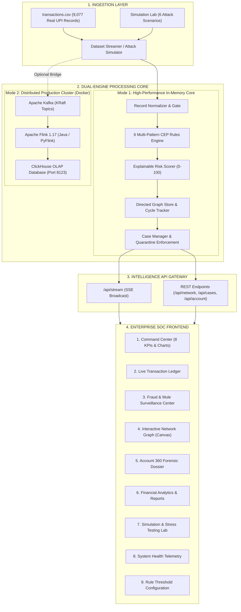

# 🛡️ SENTINEL: Real-Time UPI Fraud Intelligence & Money Mule Network Detection Platform

[](https://github.com)
[](https://clickhouse.com)
[-ef4444?style=flat-square)](https://kafka.apache.org)
[](tests/)

> **Enterprise Financial Cybersecurity SOC Platform** engineered for sub-millisecond detection, explainable risk scoring, and interactive graph investigation of Money Mule Networks, Smurfing Rings, and Rapid Fund Draining attacks across UPI (Unified Payments Interface) rails.

---

## 📌 1. Executive Summary & Problem Space

In modern instant digital banking and UPI scams, illicit funds are transferred and extracted within seconds:
1. **Victim Compromise**: Fraudsters manipulate victims into remitting funds into a compromised account (**Mule Tier-1**).
2. **Sub-Minute Layering**: Within 10 to 60 seconds, the mule forwards the balance to intermediary mules (**Tier-2 / Tier-3**) or disperses it across multiple runners.
3. **Off-Ramp Liquidation**: Funds are off-ramped via ATM cardless cashouts, hawala nodes, or P2P crypto desks before traditional batch systems can run overnight queries.

**Sentinel solves this by executing stateful stream processing with sub-millisecond detection latency**, tracking account velocity, calculating exact **Drain Percentage** and **Time-to-Drain**, tracing multi-hop graph paths, and visualizing interconnected mule rings on an interactive canvas.

---

## 🏛️ 2. High-Level Architecture & Transaction Flow



---

## 🧠 3. Advanced Fraud Detection Algorithms

Sentinel features 6 state-of-the-art fraud detection algorithms operating over sliding event windows:

### 1. Rapid In-to-Out Pass-Through Mule (`RAPID_PASS_THROUGH_MULE`)
* **Concept**: A mule account rarely holds illicit funds; money is immediately moved out.
* **Formulas**:
  $$\text{Time to Drain} = t_{\text{debit}} - t_{\text{credit}}$$
  $$\text{Drain Ratio} = \left(\frac{\text{Debit Outflow Amount}}{\sum \text{Credit Inflow Amounts}}\right) \times 100$$
* **Trigger Conditions**: $\text{Time to Drain} \le 120\text{ seconds}$ AND $\text{Drain Ratio} \ge 70\%$ AND $\text{Amount} \ge ₹5,000$.
* **Severity**: $\text{CRITICAL}$ if $\le 20\text{ seconds}$, otherwise $\text{HIGH}$.

### 2. Fan-In Smurfing Aggregator (`FAN_IN_SMURFING_AGGREGATOR`)
* **Concept**: A central fraud account receives small transfers from multiple compromised victims to evade single-transaction threshold limits.
* **Trigger Conditions**: $\ge 3$ distinct remitter accounts transferring money to the same beneficiary within a 120-second sliding window.

### 3. Fan-Out Distribution Dispersal (`FAN_OUT_DISTRIBUTION`)
* **Concept**: A primary mule receives a lump sum and immediately disperses it across $N$ distinct runner accounts within seconds.
* **Trigger Conditions**: 1 remitter dispersing funds to $\ge 3$ distinct beneficiaries within a 120-second window.

### 4. Multi-Hop Layering Chain (`MULTI_HOP_LAYERING`)
* **Concept**: Funds move along an $A \to B \to C \to D$ chain across different banks within minutes to obfuscate the paper trail.
* **Trigger Conditions**: $\text{Beneficiary}(T_x) = \text{Remitter}(T_{x+1})$ across $\ge 3$ hops within a 180-second window.

### 5. Circular Transaction Loop (`CIRCULAR_TRANSACTION_LOOP`)
* **Concept**: Artificial turnover / wash trading where money loops back to the originating entity ($A \to B \to C \to A$).
* **Trigger Conditions**: Cycle detection over directed transaction graph within max depth of 4 hops.

### 6. Structuring & Transaction Splitting (`STRUCTURING_SPLIT`)
* **Concept**: Repetitive transfers executed just below statutory regulatory reporting thresholds (e.g., ₹45,000–₹49,999) to evade anti-money laundering (AML) detection.
* **Trigger Conditions**: $\ge 3$ transfers between ₹25,000 and ₹49,999 from the same sender within 60 seconds.

---

## ⚖️ 4. Explainable Multi-Signal Risk Scoring Engine

Every alert is scored between **0 and 100** with mathematically weighted signals. No arbitrary risk scores:

| Signal Name | Weight | Condition & Contribution |
| :--- | :--- | :--- |
| `RULE_TRIGGER_BASE` | Base | +40 points base rule invocation |
| `VELOCITY_PENALTY` | Up to +25% | Drain $\le 10$s: **+25 pts** \| $\le 30$s: **+20 pts** \| $\le 60$s: **+15 pts** \| $\le 120$s: **+10 pts** |
| `DRAIN_RATIO_WEIGHT` | Up to +20% | Drain $\ge 95\%$: **+20 pts** \| $\ge 85\%$: **+15 pts** \| $\ge 70\%$: **+10 pts** |
| `NETWORK_CENTRALITY` | Up to +20% | Fan-in/fan-out degree $\ge 6$: **+20 pts** \| $\ge 4$: **+15 pts** \| $\ge 3$: **+10 pts** |
| `MULTI_HOP_LAYERING` | Up to +15% | Deep layering across $\ge 3$ hops (+5 pts per hop above 2) |
| `CIRCULAR_LOOP` | Up to +15% | +15 pts if directed cycle detected |
| `HIGH_VALUE_EXPOSURE`| Up to +10% | Transfer $\ge ₹1,00,000$: **+10 pts** \| $\ge ₹50,000$: **+5 pts** |
| `RECIDIVISM_HISTORY` | Up to +10% | Account has previous active fraud alerts (+3 pts per alert) |
| `QUARANTINE_OVERRIDE`| Critical | +10 pts if account is under active quarantine |

---

## 🖥️ 5. Operational SOC Dashboard Views

The redesigned frontend features 9 dedicated operational workspaces:

1. **📊 Command Center**: Executive overview featuring 8 real-time KPIs, rolling throughput volume time-series chart, severity distribution doughnut, and critical threat ticker.
2. **⚡ Live Transactions**: Real-time event-time UPI transaction ledger with multi-column search, status filters (SUCCESS / FAILED), and ₹40k+ high-value filters.
3. **🚨 Fraud Alerts**: Comprehensive alert cards detailing exact money routing ($Source \to Mule \to Destination$), drain speed, and transparent contributing signal points.
4. **🕸️ Network Intelligence**: Interactive HTML5 Canvas network graph. Zoom, pan, drag nodes, inspect in-degree/out-degree, and highlight multi-hop paths or loops.
5. **🔍 Account Investigation**: 360-degree forensic dossier for any VPA. Shows net balance delta, counter-party flows, case timeline, and active **Quarantine Toggle**.
6. **📈 Analytics & Reports**: Bank risk distribution, geographic breakdown, detection rule efficacy, and exportable forensic reports (JSON / CSV).
7. **🧪 Simulation Lab**: Interactive control panel to inject 6 synthetic attack vectors on demand with adjustable speed (1x to 50x) and pause/reset controls.
8. **🖥️ System Monitoring**: Processing latency (sub-millisecond), event loop health, ClickHouse sync status, and in-memory graph cardinality.
9. **⚙️ Settings**: Configurable sliding window durations, drain ratio thresholds, and reporting limits.

---

## 🚀 6. How to Run the Platform

### Option A: Zero-Dependency High-Performance Mode (Recommended)
Sentinel runs out-of-the-box using native Node.js (v16+). No Docker or external databases required.

```powershell
# Start the SOC Server & Real-Time CEP Stream
node web-dashboard/server.js
```
Open **`http://localhost:3000`** in your browser.

### Option B: Run Automated Test Suites
```powershell
# 1. Run Fraud Engine, Risk Scorer & Graph Store Verification (7/7 tests)
node tests/test_detection_engine.js

# 2. Run Zero-Socket REST API Route Integration Tests (9/9 tests)
node tests/test_server_mock.js
```

### Option C: Distributed Production Cluster (Docker Compose)
When Docker Desktop is running:
```powershell
# 1. Start Kafka (KRaft), Flink 1.17, and ClickHouse
docker compose -f docker/docker-compose.yml up -d

# 2. Run the Web Dashboard
node web-dashboard/server.js
```

---

## 📊 7. Dataset Specification (`data/transactions.csv`)

| Column | Type | Description | Sample Value |
| :--- | :--- | :--- | :--- |
| `transaction_id` | String | Unique transaction reference | `099ee548-2fc1-4811-bf92-559c467ca792` |
| `timestamp` | String | Occurrence time (`YYYY-MM-DD HH:mm:ss`) | `2024-06-19 06:04:49` |
| `sender_name` | String | Remitter legal name | `Mohanlal Bakshi` |
| `sender_vpa` | String | Remitter Virtual Payment Address | `8908837379@okaxis` |
| `receiver_name` | String | Beneficiary legal name | `Mehul Sankaran` |
| `receiver_vpa` | String | Beneficiary Virtual Payment Address | `7683454560@okaxis` |
| `amount` | Float | Transferred amount in INR (₹) | `8404.55` |
| `status` | String | Transaction outcome (`SUCCESS`, `FAILED`) | `SUCCESS` |
| `bank_code` | String | Participating PSP bank | `AXIS`, `HDFCBANK`, `ICICI`, `SBI`, `YBL` |
| `location` | String | Origination city | `Delhi`, `Mumbai`, `Ahmedabad`, `Pune` |

---

## 📁 8. Repository File Structure

```
MP1/
├── engine/                                  # Next-Gen Core Detection Engines
│   ├── rules.js                             # 6 Stateful CEP Fraud Detection Rules
│   ├── risk_scorer.js                       # Explainable Multi-Signal Risk Scorer
│   ├── graph_store.js                       # Directed Transaction Graph Store & Cycle Finder
│   ├── case_manager.js                      # SOC Case Lifecycle & Quarantine Manager
│   ├── simulator.js                         # 6-Scenario Attack Injection Engine
│   └── clickhouse_client.js                 # Sub-second ClickHouse HTTP OLAP Client
├── web-dashboard/                           # Real-Time SOC Interface & API Broker
│   ├── server.js                            # High-Throughput HTTP & SSE Gateway
│   └── public/
│       ├── index.html                       # 9-View Security Operations Center Dashboard
│       ├── styles.css                       # Enterprise Dark Cybersecurity Styling
│       └── app.js                           # Canvas Graph Visualizer & State Manager
├── tests/                                   # Automated Validation Test Suites
│   ├── test_detection_engine.js             # Engine, Risk Scorer & Graph Unit Tests
│   └── test_server_mock.js                  # Zero-Socket REST API Route Tests
├── ingestion/                               # Dataset Streamers & Batch Processors
│   ├── dataset_streamer.js                  # Batch Scanner for transactions.csv
│   └── stream_simulator.js                  # Live Sequential Replay Generator
├── flink-jobs/                              # Distributed Stream Processing
│   ├── java/                                # Production Java Flink 1.17 Topology
│   └── python/                              # PyFlink KeyedProcessFunction Pipeline
├── clickhouse/                              # OLAP Storage & Analytical Queries
│   ├── init.sql                             # Database & Materialized View DDL
│   └── queries.sql                          # Sub-second Analytical Queries
├── data/                                    # Datasets & Reports
│   ├── transactions.csv                     # 9,077 UPI Transaction Records
│   └── alerts_output.json                   # Output Incident Ledger
├── docker/                                  # Containerized Stack Definitions
│   └── docker-compose.yml                   # Kafka (KRaft), Flink, ClickHouse Stack
├── README.md                                # Platform Architectural Specification
└── Explain.md                               # In-Depth Theoretical Documentation
```

---

## 🔒 9. Security, Compliance & Quarantine Governance

* **Defensive Input Sanitization**: All HTML rendered dynamically in the dashboard passes through `escapeHtml()` to protect against Cross-Site Scripting (XSS).
* **Quarantine Enforcement**: Quarantined accounts are tracked in `quarantined_accounts.json` and in the graph store, applying an automatic critical score multiplier to all subsequent activity.
* **Audit Trail**: Every case status update and analyst note is recorded with timestamp and analyst attribution in `data/cases.json`.
* **Zero Fabrication**: Injected attacks in the Simulation Lab flow through the actual detection rules and graph algorithms. Alerts are generated only when mathematical thresholds are met.
